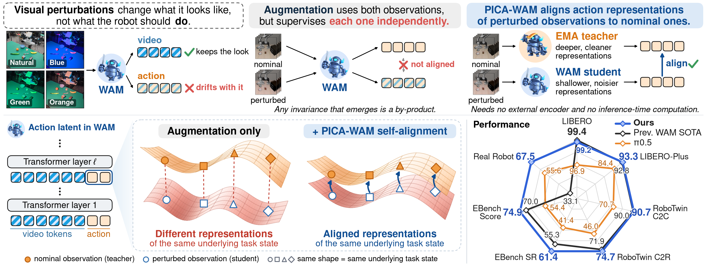
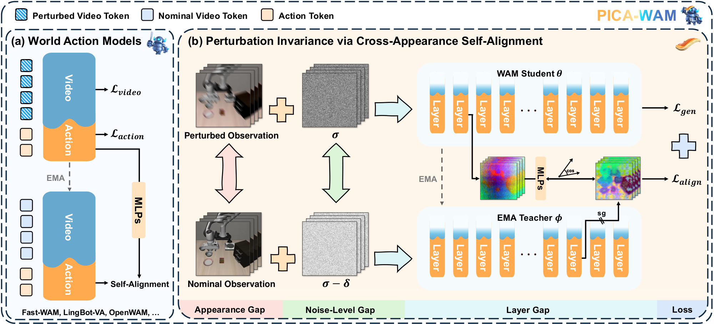
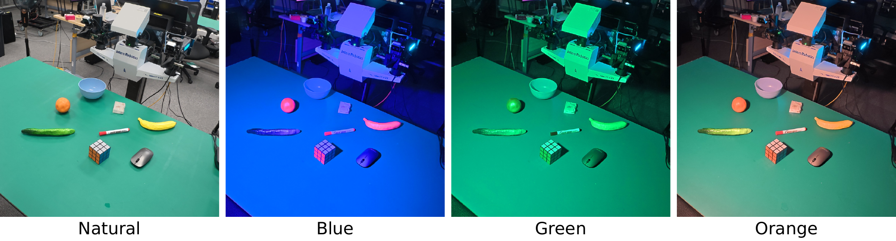
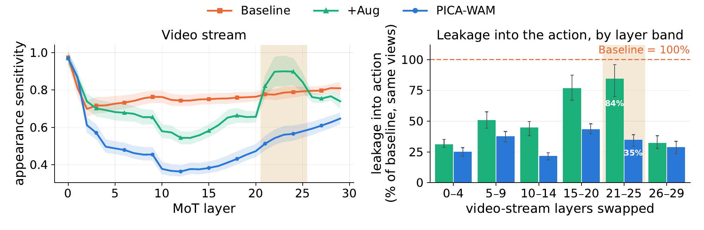
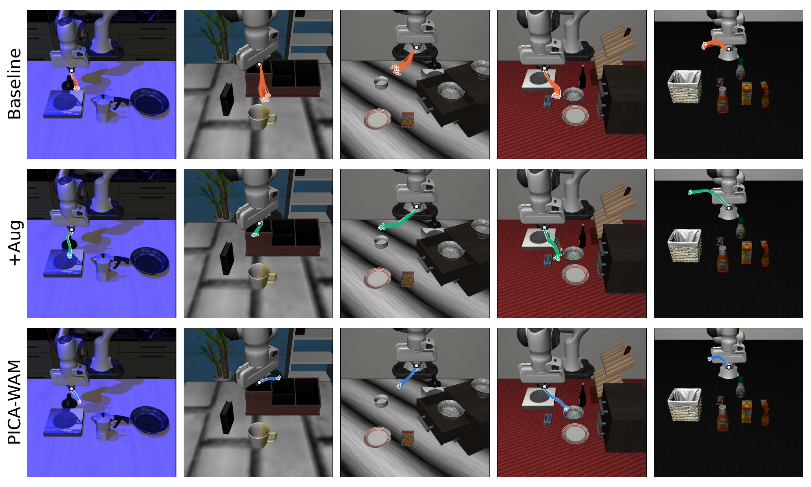

<h1 align="center">PICA-WAM: Visual Perturbation Invariance via Cross-Appearance Self-Alignment in World Action Models</h1>

<p align="center">
Yude Zou<sup>1,2*</sup> &nbsp; Yifei Yao<sup>2*</sup> &nbsp; Guanbo Jiao<sup>2,3*</sup> &nbsp; Jianming Ma<sup>1,2</sup> &nbsp; Guanjie Zheng<sup>1</sup> &nbsp; Xing Gao<sup>2&dagger;</sup><br>
<sup>1</sup>Shanghai Jiao Tong University &nbsp; <sup>2</sup>Shanghai Artificial Intelligence Laboratory &nbsp; <sup>3</sup>Fudan University<br>
<sup>*</sup>Equal contribution &nbsp; <sup>&dagger;</sup>Corresponding author
</p>

<p align="center">
<a href="https://arxiv.org/abs/2610.26813"></a>
</p>



World Action Models (WAMs) jointly predict future video and generate actions, yet remain sensitive to task-irrelevant visual perturbations, i.e., changes in visual appearance that should not affect robot behavior. We identify a gap in conventional WAM training: video prediction encourages representations to preserve appearance information, while action generation does not explicitly enforce invariance to task-irrelevant appearance. Data augmentation exposes WAMs to such perturbations but does not require perturbed and nominal observations to produce consistent action representations, and alignment with external pretrained features does not guarantee the desired invariance. To address this gap, we propose **PICA-WAM**, a self-supervised training framework that casts perturbation invariance as an auxiliary **cross-appearance self-alignment** task for WAMs. An exponential-moving-average (EMA) teacher processes the nominal observation to provide a deeper-layer target, while the online WAM processes a perturbed observation and aligns its shallower-layer action representation to this target through a lightweight projection head. Across four strong WAMs evaluated on RoboTwin 2.0, LIBERO-Plus, EBench, and a real robot, PICA-WAM consistently improves robustness under visual perturbations, preserves nominal performance in simulation, and raises the real robot success rate. PICA-WAM further reduces the sensitivity of video features to task-irrelevant appearance and its propagation into actions, as shown by paired layer-wise diagnostics.

## Method



## Results

PICA-WAM is applied to four WAMs: Fast-WAM (no embodied pretraining) and the embodied-pretrained LingBot-VA, InternW0-Δ, and OpenWAM-α. All numbers are success rates (%).

### LIBERO and LIBERO-Plus

| Method | LIBERO | Robot | Language | Light | BG | Noise | Layout | Camera | LIBERO-Plus Avg. |
| --- | --- | --- | --- | --- | --- | --- | --- | --- | --- |
| Fast-WAM | 97.6 | 44.5 | 68.9 | 78.2 | 53.7 | 37.7 | 60.7 | 16.4 | 51.5 |
| **+ PICA-WAM** | 98.2 | 95.4 | 86.5 | 94.1 | 79.3 | 94.6 | 82.6 | 64.7 | **85.2** |
| InternW0-Δ | 99.0 | 91.1 | 92.9 | 95.8 | 99.4 | 94.0 | 88.4 | 90.6 | 92.8 |
| **+ PICA-WAM** | 99.2 | 91.7 | 95.3 | 98.0 | 99.3 | 96.6 | 88.4 | 86.7 | **93.3** |

### RoboTwin 2.0 (trained on clean demonstrations only)

| Method | Clean | Randomized | Avg. |
| --- | --- | --- | --- |
| Fast-WAM | 77.8 | 1.9 | 39.9 |
| **+ PICA-WAM** | 88.0 | 39.6 | **63.8** |
| LingBot-VA | 81.2 | 29.8 | 55.5 |
| **+ PICA-WAM** | 83.1 | 57.0 | **70.1** |
| InternW0-Δ | 90.0 | 71.9 | 81.0 |
| **+ PICA-WAM** | 90.7 | 74.7 | **82.7** |

### EBench

| Method | Mobile Manip. SR | Mobile Manip. Score | Table-Top SR | Table-Top Score | Overall SR | Overall Score |
| --- | --- | --- | --- | --- | --- | --- |
| OpenWAM-α | 60.2 | 74.1 | 42.1 | 59.6 | 55.3 | 70.0 |
| **+ PICA-WAM** | 67.5 | 78.3 | 45.0 | 66.3 | **61.4** | **74.9** |

### Real robot

Eight pick-up tasks on an ARX-Lift2 dual-arm robot, evaluated under natural lighting and three colored lights, with a new tabletop and new instances of three objects (160 trials per method).



| Method | Success rate |
| --- | --- |
| π0.5 | 55.6 |
| OpenWAM-α | 33.1 |
| **+ PICA-WAM** | **67.5** |

### Paired layer-wise diagnostics

Augmentation alone leaves late video layers sensitive to task-irrelevant appearance and lets this sensitivity reach the action. PICA-WAM reduces both, and the executed trajectories from nominal and perturbed observations stay close.





## Open-source plan

We plan to release the code and checkpoints in **November 2026**.

- [x] Project repository with figures and main results
- [x] [Paper on arXiv](https://arxiv.org/abs/2610.26813)
- [ ] PICA-WAM checkpoints and evaluation code
- [ ] PICA-WAM training code

## Citation

```bibtex
@misc{zou2026picawamvisualperturbationinvariance,
      title={PICA-WAM: Visual Perturbation Invariance via Cross-Appearance Self-Alignment in World Action Models},
      author={Yude Zou and Yifei Yao and Guanbo Jiao and Jianming Ma and Guanjie Zheng and Xing Gao},
      year={2026},
      eprint={2610.26813},
      archivePrefix={arXiv},
      primaryClass={cs.CV},
      url={https://arxiv.org/abs/2610.26813},
}
```
